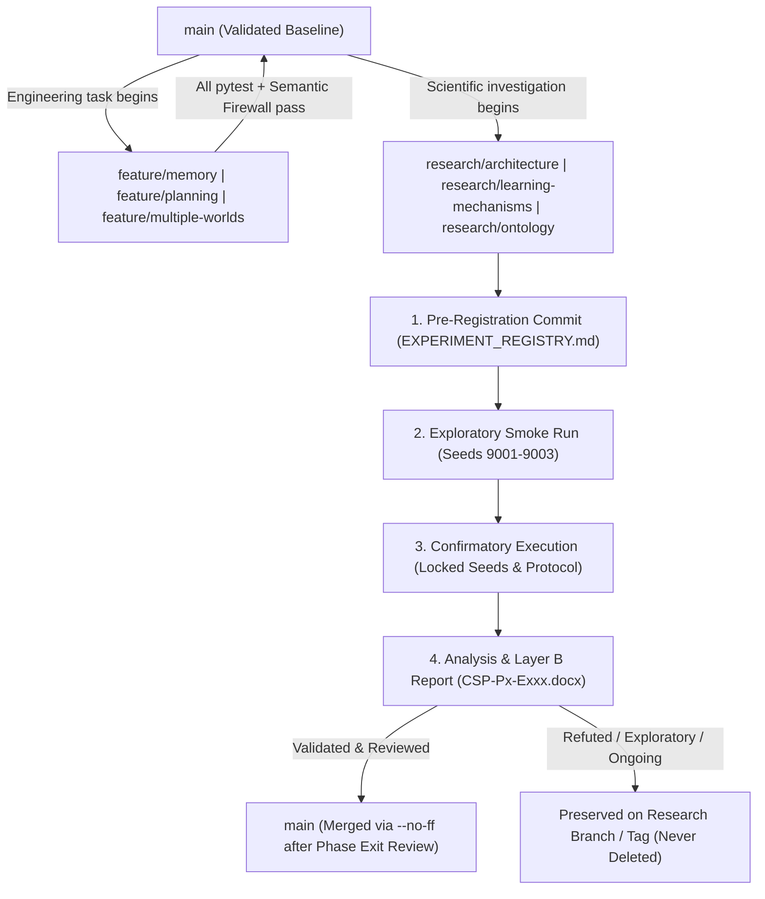

# Project Caspian — Git Branching & Experimental Traceability Strategy

**Document ID:** `CSP-DEV-BRANCH-001`  
**Status:** Active Governance Standard  
**Applies to:** All Project Caspian code, configurations, pre-registrations, experiments, and reports.

---

## 1. Purpose and Guiding Principle

Project Caspian is a **scientific research programme** investigating Artificial Ontological Intelligence (AOI), not merely a software engineering project.

In a conventional software repository, version control exists primarily to ship features and discard superseded code. In Project Caspian, Git serves as part of the **scientific instrument**:

1. Every empirical claim must trace to an exact, immutable **Git commit hash**.
2. **Pre-registration commits** must precede confirmatory experimental runs to prove that hypotheses, thresholds, and exclusion criteria were fixed before observing confirmatory outcomes.
3. **Failed, null, or refuted experiments** are first-class scientific evidence and must remain permanently accessible in repository history.
4. Parallel exploration of neural architectures, learning mechanisms, and ontological representations must never contaminate the validated baselines on `main`.

> **Core Rule:** Do not introduce branching complexity for its own sake. Every branch must isolate a well-defined research question or capability implementation while keeping experimental provenance exact and auditable.

---

## 2. Branch Hierarchy & Naming Conventions

Project Caspian uses a three-tier branch structure:

| Tier | Naming Pattern | Lifespan | Primary Purpose |
| :--- | :--- | :--- | :--- |
| **1. Main** | `main` | Permanent | Validated baseline implementation, completed phase artifacts, and reviewed scientific records. |
| **2. Research** | `research/<topic>` | Medium / Long-lived | Scientific investigations into architectures, learning dynamics, and ontological representations. |
| **3. Feature** | `feature/<capability>` | Short / Task-scoped | Controlled engineering implementation of new environment, agent, memory, or planning capabilities. |

### 2.1 Main Branch (`main`)
* **Purpose:** Holds the stable, validated Caspian implementation, verified unit test suite, completed phase experiments (`Phase 0` through `Phase 12+`), raw confirmatory logs (`logs/`), and permanent `.docx` experiment reports (`docs/`).
* **Protection Rules:**
  * Never commit unvalidated exploratory scripts, broken tests, or unreviewed architectural changes directly to `main`.
  * Never overwrite existing raw experiment logs (`logs/`) or historical `.docx` reports without archiving originals (enforced programmatically via `experiments/safe_io.py`).
  * Never rewrite history (`git rebase`, `git commit --amend`, `git reset --hard`) or force-push on `main`.

### 2.2 Research Branches (`research/*`)
Used to isolate scientific hypotheses, ablation studies, and comparative experiments from the stable baseline:

* **`research/architecture`**
  * *Scope:* Alternative neural architectures (`PredictiveMLP`, `RecurrentPredictiveModel`, `DeepSetsPredictiveModel`, `AdditiveModel`, `FactorisedModel`, `AdditiveResidualModel`, and Phase 14 interaction-aware networks), model capacity sweeps, and structural inductive-bias comparisons.
* **`research/learning-mechanisms`**
  * *Scope:* Optimization sensitivity, online vs. offline adaptation (`OnlineAdaptationTrainer`), representation learning from raw observations (Phase 13), sample efficiency, and continual learning / catastrophic forgetting studies (Phase 17).
* **`research/ontology`**
  * *Scope:* Emergent category formation (Phase 5), autonomous property discovery (Phase 13), non-additive property interactions (Phase 14), causal intervention learning (Phase 15), and compositional generalisation.

### 2.3 Feature Branches (`feature/*`)
Used when building and unit-testing specific software infrastructure or agent capabilities before running scientific experiments on them:

* **`feature/memory`** — Persistent environmental memory, recurrent/state-space extensions, and cross-episode retrieval mechanisms (supporting Phase 17).
* **`feature/planning`** — Multi-step rollout simulation, uncertainty-aware planning, and counterfactual action evaluation (supporting Phase 18).
* **`feature/multiple-worlds`** — Multi-world environment generators, cross-world transfer harnesses, and distribution-shift benchmarks (supporting Phase 16).

---

## 3. Branch Workflow Diagram

```text
main (stable, validated baselines & completed phase reports)
 │
 ├──► feature/memory ──────────────► (unit tests + semantic firewall audit) ──┐
 │                                                                            ▼
 │                                                                           main
 │                                                                            ▲
 └──► research/ontology                                                       │
       │                                                                      │
       ├── commit A: Pre-register hypotheses & protocol (EXPERIMENT_REGISTRY) │
       ├── commit B: Exploratory smoke test (seeds 9001-9003)                 │
       ├── commit C: Confirmatory run (locked protocol, disjoint seeds)       │
       └── commit D: Analysis & DOCX report (CSP-P<phase>-E<num>.docx) ───────┘
                     (Merge --no-ff into main if validated;
                      retain branch/tag if null, refuted, or ongoing)
```



---

## 4. When to Create (and When to Defer) a Branch

1. **Create a branch only when active work begins:**
   * Do **not** create empty placeholder branches for every future phase or micro-change.
   * Create a `feature/<name>` branch only when engineering work on that capability starts.
   * Create or check out the relevant `research/<domain>` branch when designing or executing an experimental suite.
2. **Branch from a clean `main` baseline:**
   * Always verify `git status` is clean and `pytest` passes on `main` before branching:
     ```bash
     git checkout main
     pytest
     git checkout -b research/ontology
     ```
3. **Keep `feature/*` and `research/*` responsibilities separate:**
   * Do not mix unverified simulator changes with confirmatory scientific runs in a single uncommitted working tree. Implement and test simulator/model primitives first, commit them cleanly, and then register the experiment.

---

## 5. Experimental Integrity & Commit Recording Protocol

Every experiment conducted in Project Caspian must preserve **ten mandatory elements**:

1. **Experiment ID** (e.g., `CSP-P13-E001`).
2. **Research hypothesis** (including explicit directional predictions and null hypothesis).
3. **Experimental protocol** (pre-registered statistical test $T$, margins, and stopping/exclusion rules).
4. **Configuration and hyperparameters** (JSON config in `configs/` or locked world/model factory parameters).
5. **Random seeds** (strictly separating exploratory smoke seeds such as `9001–9003` from confirmatory seed sets such as `1–10` or `11–20`).
6. **Dataset or environment specification** (world dimensions, entity pool, hidden rules, observability, and sample budgets).
7. **Git commit hash** (`git rev-parse HEAD` at pre-registration and at confirmatory execution).
8. **Results and evaluation metrics** (saved via `safe_write_json` in `logs/phase<N>/` with raw `.npz` predictions/weights where applicable).
9. **Experiment report** (`docs/CSP-P<phase>-E<num>.docx` following the 24-section Layer B standard).
10. **Reproducibility information** (exact CLI commands executed, software versions, and `OPERATIONAL_RECORD.md`).

### 5.1 Two-Stage Commit Discipline for Confirmatory Experiments

To maintain a strict firewall between **exploratory** work and **confirmatory** science (as established in Phases 10–12):

1. **Stage A — Pre-Registration Commit (Before Confirmatory Data Collection):**
   * Write the experimental design, hypotheses, thresholds, seed lists, and exclusion criteria in `docs/phase<N>/EXPERIMENT_REGISTRY.md` (and `HYPOTHESES.md` if separate).
   * Implement the experiment script and pass unit tests (`pytest`).
   * Commit the registration and code **before** running the confirmatory seed matrix:
     ```bash
     git add docs/phase<N>/ experiments/ models/ tests/
     git commit -m "exp(phase<N>): pre-register CSP-P<N>-E001 protocol and hypotheses"
     git rev-parse HEAD   # Record this hash in OPERATIONAL_RECORD.md
     ```
   * *(Optional)* Run exploratory smoke seeds (`9001–9003`) to verify pipeline finiteness and zero semantic leakage. Any change made after viewing smoke results must be disclosed in `EXPERIMENT_REGISTRY.md`.

2. **Stage B — Confirmatory Execution & Results Commit:**
   * Verify `git status` shows a clean working tree at the registered commit.
   * Execute the confirmatory run and analysis script.
   * Generate the `.docx` report (`docs/CSP-P<N>-E001.docx`) and record the pre-registration and execution commit hashes in `docs/phase<N>/OPERATIONAL_RECORD.md`.
   * Commit all raw outputs, analysis JSONs, and reports:
     ```bash
     git add logs/phase<N>/ docs/phase<N>/ docs/CSP-P<N>-E001.docx
     git commit -m "exp(phase<N>): record confirmatory results and DOCX report for CSP-P<N>-E001"
     ```

---

## 6. How to Merge Validated Changes into `main`

Changes from a `research/*` or `feature/*` branch may be merged into `main` **only** after passing the **Phase Exit / Merge Review Checklist**:

- [ ] **All unit and regression tests pass:** `pytest` exits with `0` failures across all phases.
- [ ] **Semantic Firewall verified:** `Observation.assert_semantic_purity()` passes and zero semantic leakage occurred in inputs, targets, or architecture.
- [ ] **Baseline preservation verified:** No existing files in `logs/` or `docs/CSP-P*.docx` were overwritten or mutated (`git diff main -- logs/ docs/` shows only additions or explicitly archived revisions).
- [ ] **Protocol integrity verified:** Pre-registered hypotheses in `EXPERIMENT_REGISTRY.md` were not altered post-hoc after confirmatory runs began.
- [ ] **Documentation complete:** `OPERATIONAL_RECORD.md` and `docs/CSP-P<N>-E<M>.docx` are committed and reference the exact Git commit hashes.

### Merge Procedure
Use a non-fast-forward merge (`--no-ff`) so the branch topology explicitly records the research or feature integration boundary:

```bash
git checkout main
git merge --no-ff research/ontology -m "merge(research/ontology): integrate validated Phase <N> experiments and report"
```

---

## 7. Handling Failed, Null, or Refuted Experiments

In Project Caspian, a refuted hypothesis (for example, Phase 5 E002–E004 showing index-based encodings cannot zero-shot generalize to unseen type codes, or Phase 11/12 showing strict additive models fail on non-additive interaction worlds) is a **valuable scientific finding**, not a software bug.

1. **Never delete or rewrite a failed experiment:**
   * Commit the raw logs (`logs/`), analysis output, and `.docx` report on the research branch with verdict `NOT SUPPORTED`, `REFUTED`, or `INCONCLUSIVE`.
2. **Distinguish engineering bugs from scientific failures:**
   * If a run failed due to a code defect (e.g., `IndexError`, shape mismatch, or unintended data leakage), document the defect in `KNOWN_ISSUES.md` / `OPERATIONAL_RECORD.md`, fix the bug in a new commit, and archive the defective log rather than silently overwriting it.
   * If the code ran as designed and the model failed to learn or generalize, **do not tune hyperparameters or alter architecture on confirmatory seeds to manufacture a positive result**.
3. **Preserving unmerged research branches:**
   * If an experimental architecture or learning mechanism on a `research/*` branch proves inferior and should not become part of the core codebase on `main`, **do not delete the branch**. Keep the branch (or create an annotated tag such as `archive/CSP-P13-failed-encoder`) so the exact code and results remain permanently inspectable.

---

## 8. Preventing Contamination of Experimental Baselines

To ensure historical baselines remain valid across phases:

1. **Overwrite Protection (`experiments/safe_io.py`):** Always write experiment JSON outputs through `safe_write_json()`, which automatically appends a UTC timestamp if a target file already exists unless `CASPIAN_ALLOW_OVERWRITE=1` is explicitly set.
2. **Backward-Compatible Core Interfaces:** Modifying shared modules (`environment/world.py`, `environment/observations.py`, `models/mlp.py`, `learning/dataset.py`) requires default parameter values that preserve exact bit-for-bit behavior for all prior phases (verified by running the full `pytest` suite).
3. **Disjoint Seed Sets:** Never reuse confirmatory seeds from an earlier tuning sweep when claiming an independent confirmatory test (e.g., Phase 12 used seeds `11–20`, disjoint from Phase 11's seeds `42, 101, 7, 2026, 555, 1–5`).
4. **No Silent Config Edits:** Never modify an existing `configs/phase*.json` file used by a completed phase; create a new versioned configuration file instead.

---

## 9. Mandatory Git Safety Rules

All human researchers and autonomous coding agents working in this repository must obey the following safety constraints:

| Forbidden Action | Reason | Permitted Alternative |
| :--- | :--- | :--- |
| `git reset --hard` | Destroys uncommitted experimental work or logs. | `git status`, `git diff`, or `git stash` (with explicit reporting). |
| `git push --force` | Overwrites remote commit history and invalidates recorded hashes in reports. | Standard `git push` of new commits only. |
| `git rebase` / `git commit --amend` (on registered/published commits) | Changes SHA-1 commit hashes referenced by `OPERATIONAL_RECORD.md` and `.docx` reports. | Create a new forward commit documenting the fix or amendment. |
| `git branch -D <branch>` (on branches with unique history) | Destroys unmerged experimental trails and negative results. | Keep the branch or tag its head before retiring. |
| Modifying `logs/` or `docs/CSP-P*.docx` from completed phases | Violates scientific record immutability (Section 41 & 46 of Development Plan). | Write new outputs to `logs/phase<N>/` and archive prior artifacts in `logs/archive_*/`. |
